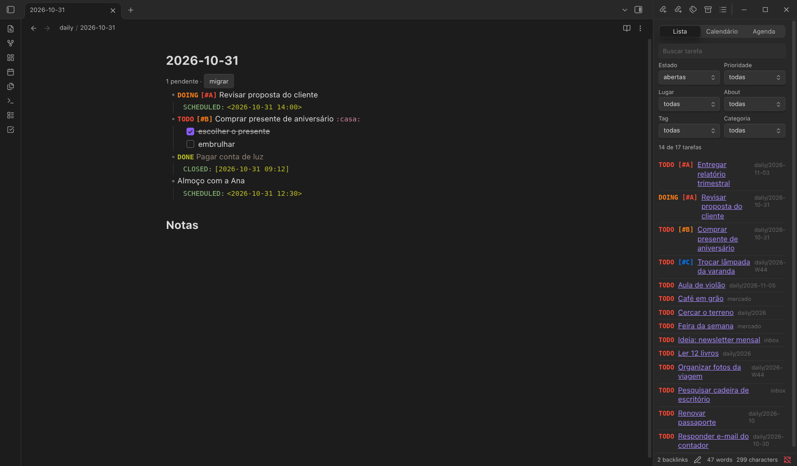
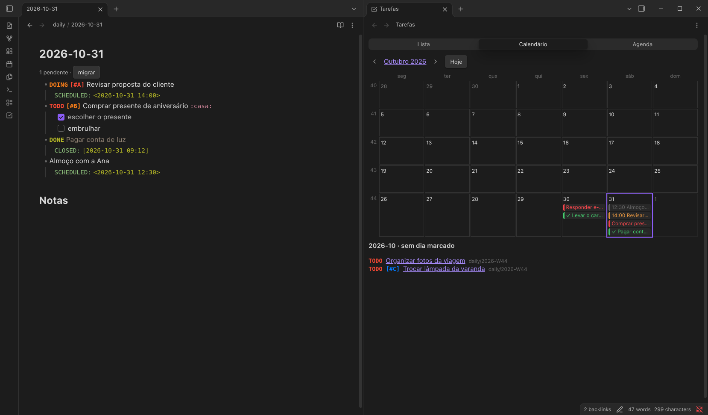
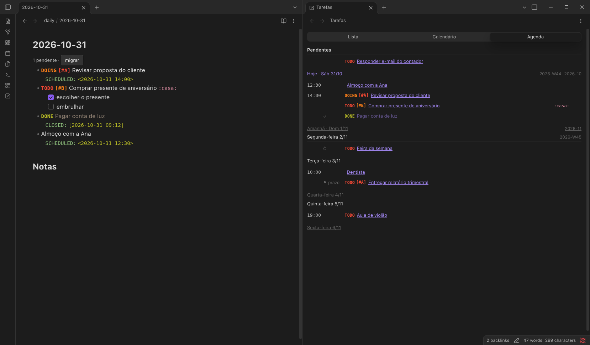
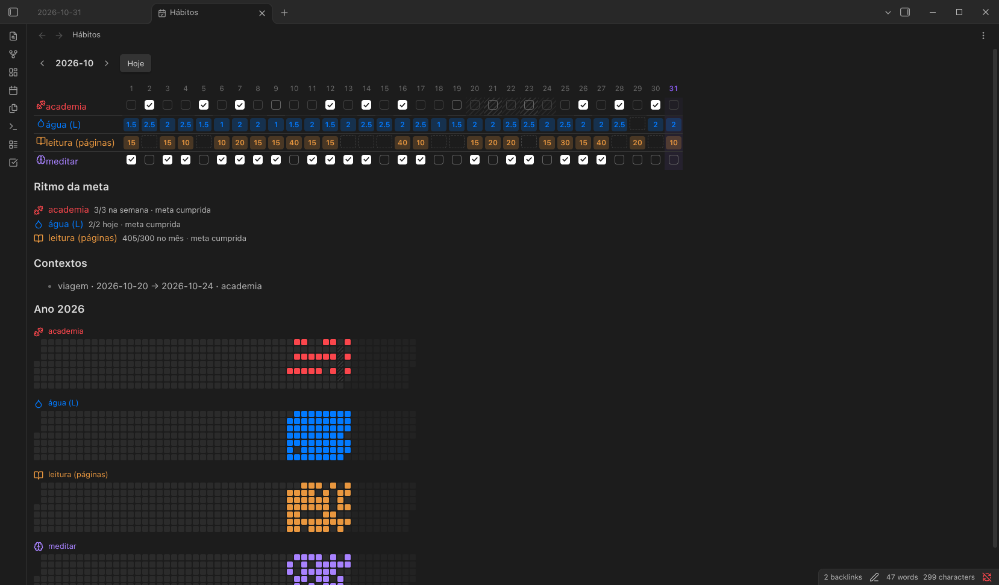

# obsidian-tide

Plugin do Obsidian: bullet journal em linhas org, hábitos e agenda. As tarefas ficam nas suas notas, em texto; o plugin lê, mostra e move.



## Como funciona

As tarefas moram numa escada de lugares: **ano → mês → semana → dia**, mais as **listas** e a **Inbox**. Você puxa tarefas para baixo e migra as pendentes à mão; o plugin nunca move nada sozinho.

| Lugar            | Arquivo                                             |
| ---------------- | --------------------------------------------------- |
| dia              | a daily do plugin core Daily notes (`2026-10-31`)   |
| semana, mês, ano | `2026-W44`, `2026-10`, `2026` na pasta dos períodos |
| lista            | qualquer nota com `categories: [[lists]]`           |
| Inbox            | `inbox.md`                                          |

Uma tarefa é um item de lista em org:

```
- TODO [#A] Entregar relatório :trabalho:
	DEADLINE: <2026-11-03>
	- [ ] revisar números
- DONE Pagar conta de luz
	CLOSED: [2026-10-31 09:12]
- Dentista
	SCHEDULED: <2026-11-03 10:00>
```

- Estados `TODO`, `DOING`, `DONE`, `CANCELED`; prioridades `[#A]` a `[#C]`.
- `Shift+→/←` muda o estado e `Shift+↑/↓` a prioridade. Também pela paleta de comandos.
- Uma linha sem estado com `SCHEDULED` é um evento.
- Repetições (`+1w`) moram em listas. Uma linha fora dessa regra ganha um sublinhado, e **Corrigir linha fora da regra** a conserta.
- O bloco ` ```tide-tasks``` ` na daily de hoje avisa das pendentes de dias anteriores, com o botão **migrar**.

## Tarefas: lista, calendário e agenda

**Abrir tarefas** abre um painel com três abas. A lista filtra por estado, prioridade, lugar, tag e categoria.





Outros comandos: **Mover para…**, **Migrar pendentes para hoje**, **Abrir esta semana/mês/ano** e **Capturar na Inbox**. A captura também funciona de fora do app, por `obsidian://tide-capture?text=…`.

## Hábitos

Um hábito é uma nota com `categories: [[habits]]`. **Novo hábito** cria uma a partir do template:

```
---
categories:
  - "[[habits]]"
unit: L            # vazio = sim/não
days: [mon, wed]   # vazio = todo dia
goal: 2
goal_per: day      # day, week, month ou year
icon: droplet
color: blue
archived: false
---

## registro
- [[2026-10-30]] 1.5
- [[2026-10-31]] 2
```

Marque pela view **Abrir hábitos**. Cada marcação vira uma linha em `## registro`, com o link da daily, então a nota continua legível sem o plugin.



**Contextos** pausam hábitos por um período, como numa viagem. Uma nota com `categories: [[contexts]]` e `pause: [[academia]]` recebe linhas `- 2026-10-20 → 2026-10-24 [[academia]]` pelo comando **Declarar contexto**.

## Templates

Ao iniciar, o plugin cria na pasta de templates `Week Template`, `Month Template`, `Year Template` e `Habit Template`, só os que ainda não existem. Depois disso eles são seus para editar. Nos períodos, `{{date}}` vira o primeiro dia do período.

## Configurações

Pasta dos períodos, arquivo da Inbox, marcadores de lista, hábito e contexto (uma propriedade como `categories: [[lists]]` ou o nome de uma pasta), pasta de templates, visual das tarefas (org ou checkbox), formato das datas (só a data ou com o dia da semana) e tema de cor.

## Instalação

Ainda não está na loja de plugins. Rode `npm install && npm run build` e copie `main.js`, `manifest.json` e `styles.css` para `.obsidian/plugins/tide/` no seu vault e ative **Tide** em _Settings → Community plugins_.

## Desenvolvimento

```sh
npm install
npm run dev    # build com watch
npm test       # vitest
npm run build  # typecheck + build de produção
```
